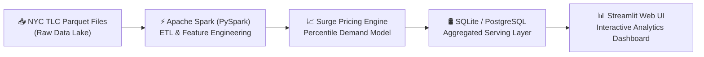

# 🚕 Urban Mobility & Surge Pricing Analytics

An end-to-end Big Data analytics pipeline that analyzes millions of NYC taxi rides to uncover traffic congestion patterns, identify lucrative pickup hotspots by time of day, and simulate real-time surge pricing rules.

---

## 🏗️ Architecture



---

## 📁 Project Structure

```
BDA_project/
├── .gitignore                     # Git ignore rules for venv, parquet, and DB files
├── requirements.txt               # Pinned Python package dependencies
├── README.md                      # Project documentation and execution instructions
├── data/
│   ├── raw/                       # Place downloaded NYC TLC Parquet files here
│   ├── processed/                 # Spark output CSVs (aggregated summaries)
│   └── lookup/
│       └── taxi_zone_lookup.csv   # NYC Taxi zone metadata
├── scripts/
│   ├── 01_ingest_validate.py      # Schema check and raw data validation
│   ├── 02_spark_process.py        # Core PySpark cleaning, features & aggregations
│   ├── 03_load_to_db.py           # Loads processed CSV summaries into SQLite/Postgres
│   └── 04_surge_pricing.py        # Dynamic surge multiplier simulation engine
├── dashboard/
│   └── app.py                     # Interactive Streamlit analytics dashboard
└── db/
    ├── schema.sql                 # Serving layer database schema
    └── mobility.db                # SQLite database (auto-populated by script 03)
```

---

## 🚀 Quickstart Guide

### 1. Activate Virtual Environment
```powershell
.\.venv\Scripts\activate
```

### 2. Verify Raw Files
Place your 3–6 months of Yellow Taxi `.parquet` files in `data/raw/` and `taxi_zone_lookup.csv` in `data/lookup/`.

### 3. Pipeline Execution Sequence
Run the scripts in order:

```powershell
# Step 1: Validate data and inspect schemas
python scripts/01_ingest_validate.py

# Step 2: Run Big Data PySpark ETL (cleans and aggregates millions of rides)
python scripts/02_spark_process.py

# Step 3: Run the surge pricing simulation model
python scripts/04_surge_pricing.py

# Step 4: Populate the serving database
python scripts/03_load_to_db.py

# Step 5: Launch the Streamlit dashboard
streamlit run dashboard/app.py
```
